# Claude + Blender: clay renders and mistakes log

Follow-up to my r/ClaudeAI post. A few people asked whether these scenes were actually built in Blender, so here are clay renders of every scene.

For each scene there are three images:

- **final**: the image from the post (Cycles, 4K)
- **clay**: the same .blend and the same camera, with every texture and material replaced by one plain grey material, scene lights replaced by a single neutral sun, and fog volumes hidden
- **pulled back**: a second camera moved back and up from the shot camera, still in clay, so you can see how the set is built around the shot

Things you'll notice in the clay versions: leaves show up as solid rectangles, because the grey material ignores the leaf alpha masks. The flat areas are water planes. The fog, sun rays and aurora in the finals are volumes and lighting, so they don't appear here.

The distant mountains are real geometry (lidar/DEM terrain for the fjord and the Grand Canyon), not a skybox or an HDRI backplate.

I can't share the .blend files because they contain paid assets (FlipBox, BlenderKit) that I'm not allowed to redistribute.

[`MISTAKES.md`](MISTAKES.md) is the log Claude kept of what went wrong and what fixed it.

## 1. Foggy valley at sunrise

| final | clay | pulled back |
|---|---|---|
| 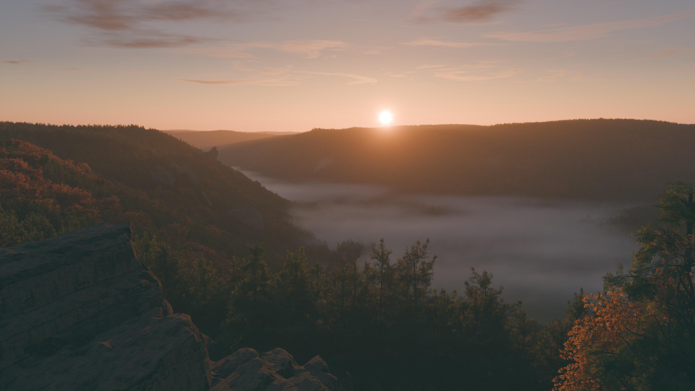 | 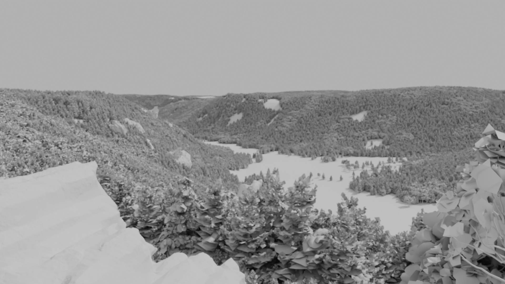 | 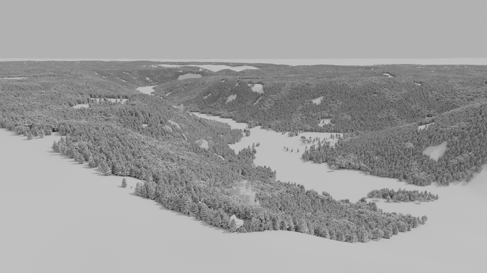 |

## 2. Fjord with aurora

| final | clay | pulled back |
|---|---|---|
| 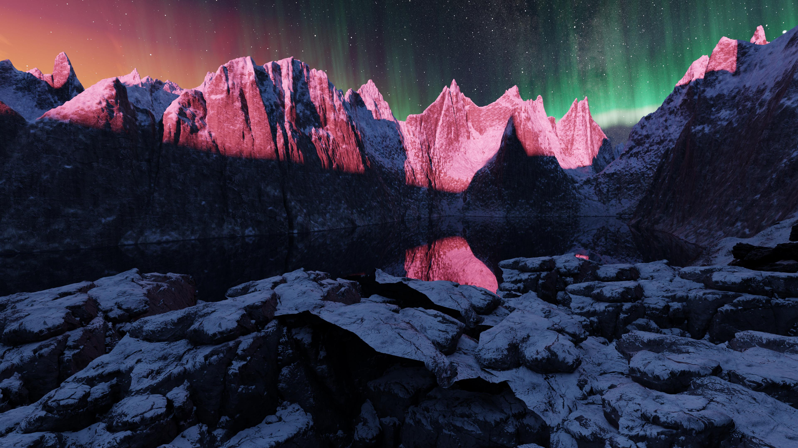 | 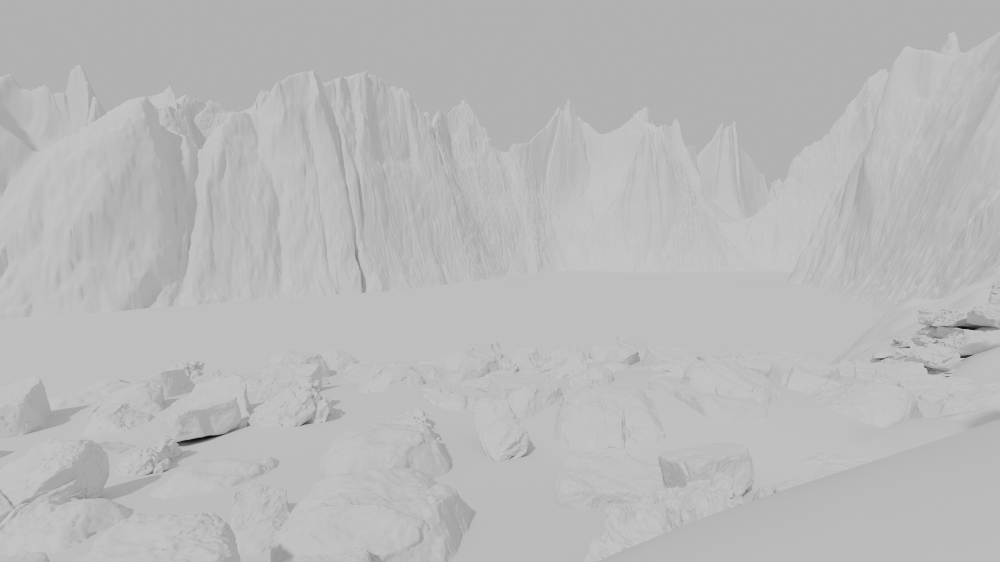 | 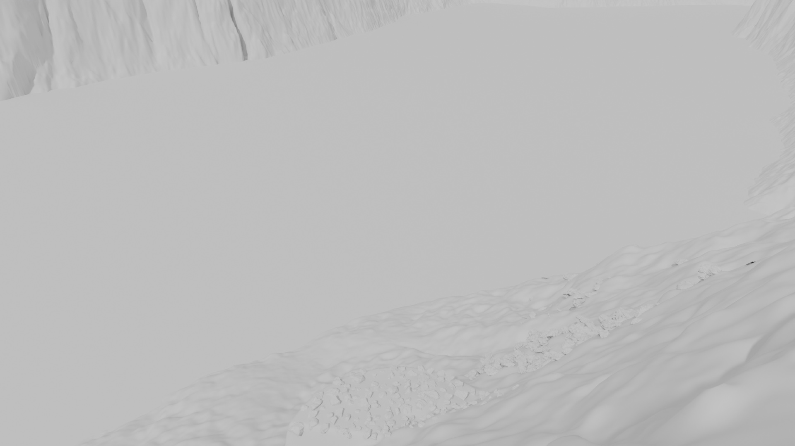 |

## 3. Rainforest

| final | clay | pulled back |
|---|---|---|
| 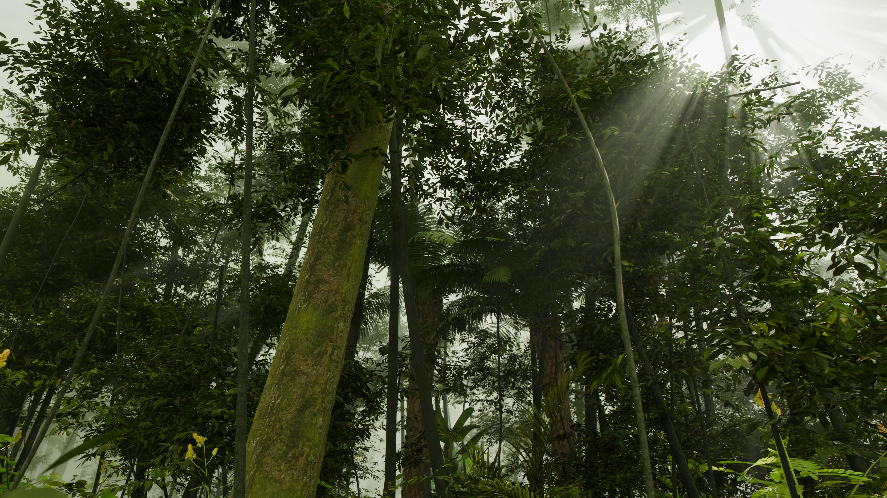 | 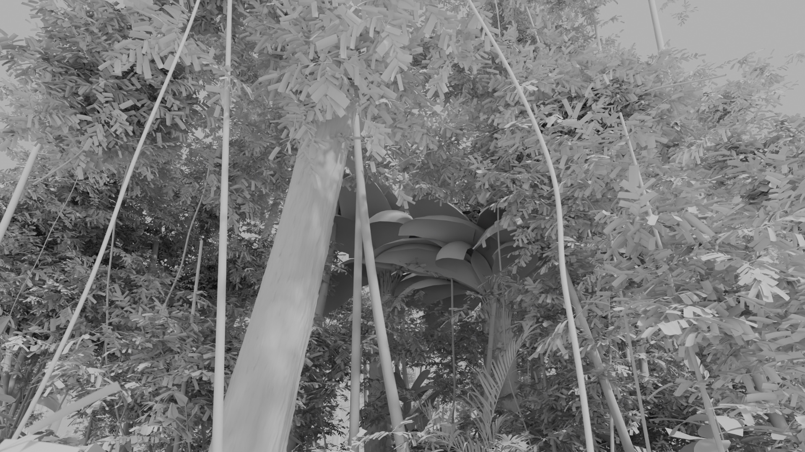 | 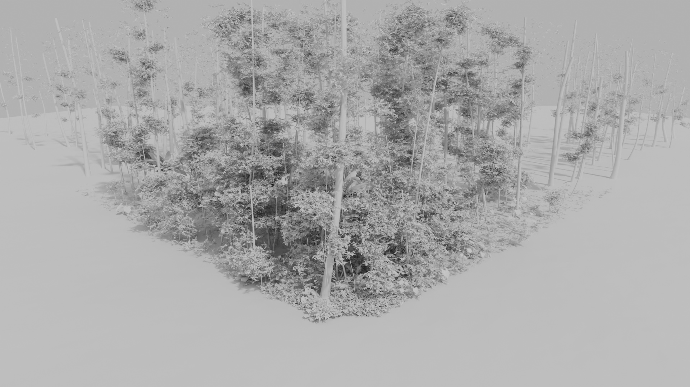 |

## 4. Grand Canyon

| final | clay | pulled back |
|---|---|---|
| 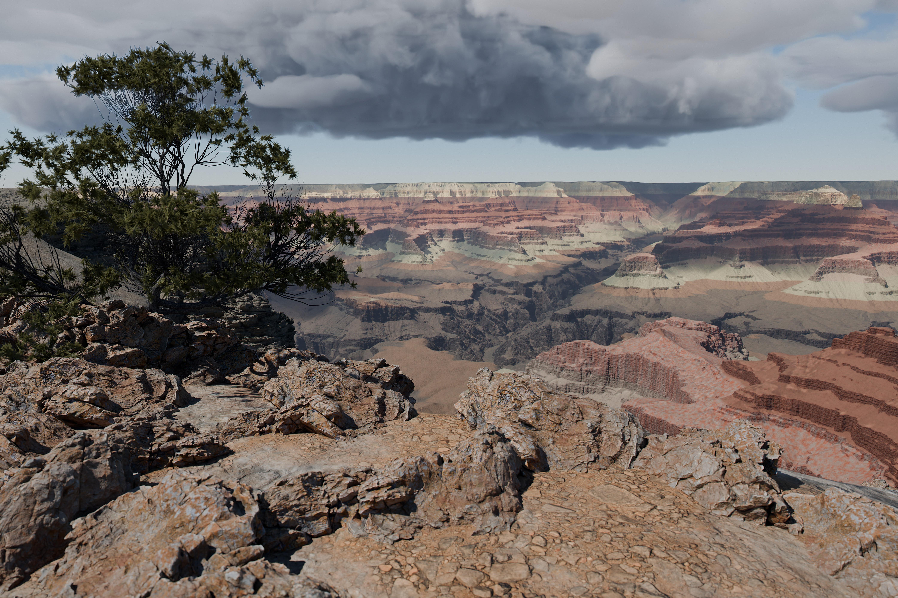 | 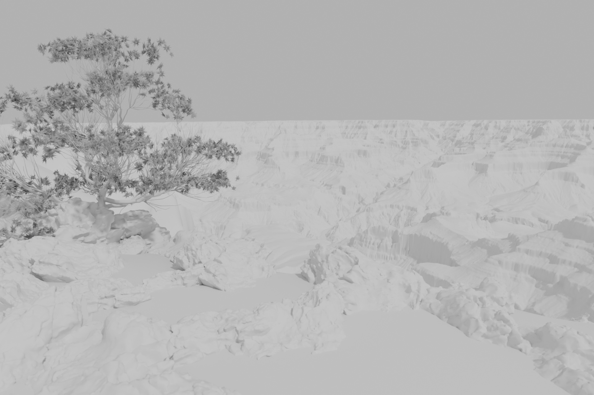 | 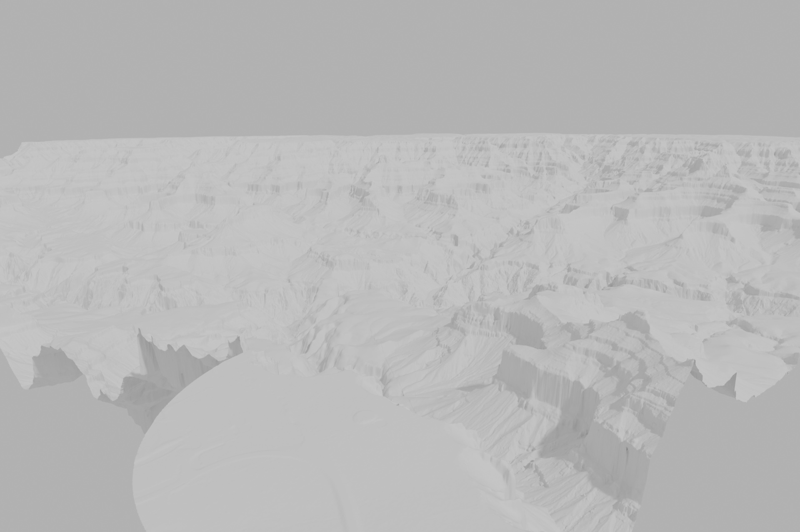 |

## 5. Mekong delta

| final | clay | pulled back |
|---|---|---|
| 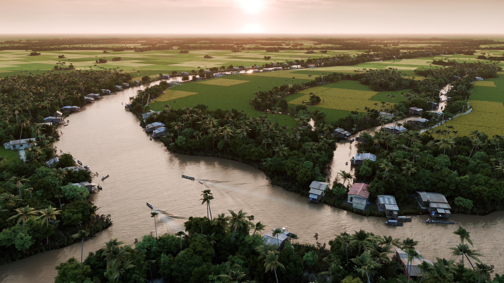 | 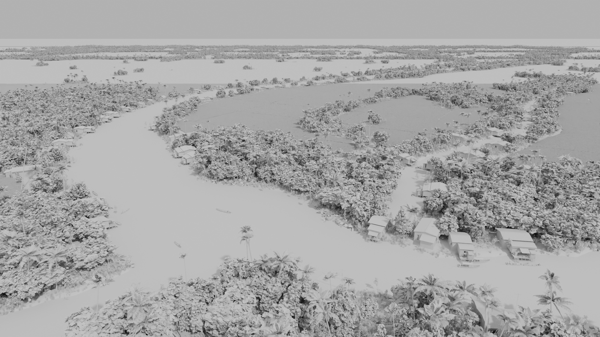 | 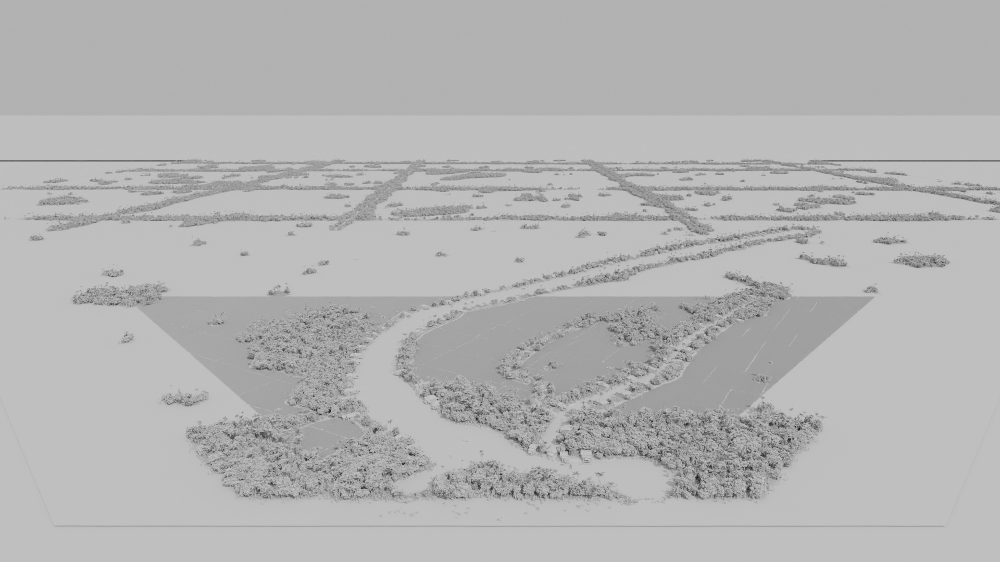 |

